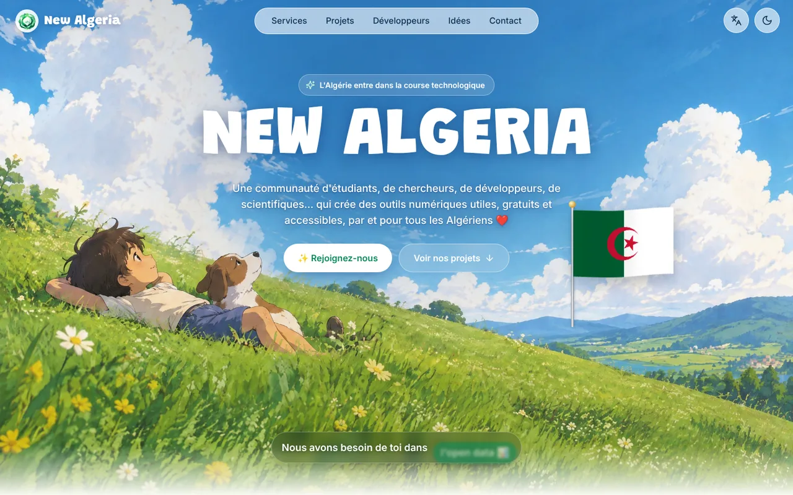
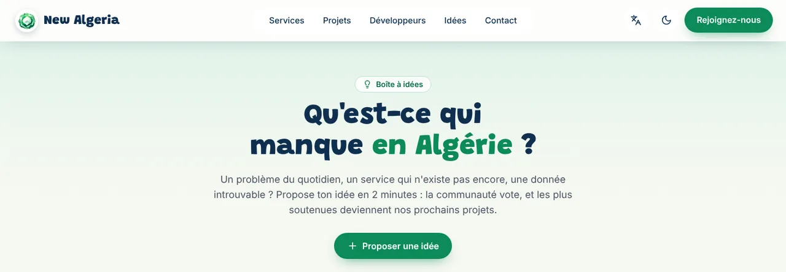

<div align="center">


### Construire le futur numérique de l'Algérie 🇩🇿

Une communauté d'étudiants, de chercheurs, de développeurs et de scientifiques
qui crée des outils numériques utiles, gratuits et accessibles, par et pour tous les Algériens.

[🌐 newalgeria.org](https://www.newalgeria.org) · [📊 data-dz](https://www.data-dz.com) · [🔌 API](https://www.data-dz.com/api) · [🤖 DjazAI](https://www.data-dz.com/djazai) · [✉️ Contact](mailto:admin@newalgeria.org)




</div>

---

## 🌟 À propos

Ce dépôt contient le **site officiel de New Algeria**, [newalgeria.org](https://www.newalgeria.org). Il présente les projets de la communauté, permet de la rejoindre et accueille la **boîte à idées**, où chacun propose ce qui manque en Algérie.

### 🚀 Nos projets

| Projet | |
|---|---|
| [**data-dz**](https://www.data-dz.com) | Toute l'Algérie en chiffres et en cartes : le portail des données ouvertes sur l'Algérie 📊 ([dépôt](https://github.com/new-algeria/data-dz)) |
| [**data-dz/api**](https://www.data-dz.com/api) | L'API publique et gratuite de data-dz, sans clé 🔌 |
| [**DjazAI**](https://www.data-dz.com/djazai) | L'assistant qui répond à partir des données de l'Algérie et cite ses sources 🤖 |
| [**Communauté**](https://github.com/new-algeria) | Devs, data scientists, designers : on construit ensemble sur GitHub 💚 |

## ✨ Ce que fait le site

- 🏠 **Accueil** : hero animé, projets, façons de contribuer, services, réalisations avec aperçu des sites, FAQ et contact
- 💡 **Boîte à idées** (`/ideas`) : propose une idée, vote pour celles des autres, commente ; l'équipe répond et fait avancer les statuts (nouvelle → à l'étude → retenue → en cours → réalisée)
- 👤 **Comptes partagés avec data-dz** : un seul compte pour tous les sites New Algeria, profil et page publique de chaque membre (`/profile`, `/members/:pseudo`)
- 🔔 **Notifications** : réponses de l'équipe, commentaires et réponses sur tes idées
- 🤝 **Rejoindre la communauté** : invitation dans l'organisation GitHub
- 🌍 **Trilingue** (français, anglais, arabe de droite à gauche), 🌗 thème clair ou sombre, responsive

<div align="center">

</div>

## 🛠️ Stack technique

- [React 18](https://react.dev), [TypeScript](https://www.typescriptlang.org), [Vite](https://vitejs.dev) (SWC)
- [Tailwind CSS](https://tailwindcss.com), [shadcn/ui](https://ui.shadcn.com), [Framer Motion](https://www.framer.com/motion/)
- [Supabase](https://supabase.com) (même projet que data-dz : comptes, idées, votes, commentaires, notifications)
- [i18next](https://www.i18next.com) pour les traductions
- [Vercel](https://vercel.com) pour l'hébergement et les statistiques de visite

## 🚀 Démarrer en local

**Prérequis** : Node.js 18 ou plus (22 conseillé) et npm.

```sh
git clone https://github.com/new-algeria/new-algeria.git
cd new-algeria
cp .env.example .env.local
npm install
npm run dev
```

Le site s'ouvre sur **http://localhost:8080** 🎉

### 🔑 Variables d'environnement

| Variable | Rôle |
|---|---|
| `VITE_SUPABASE_URL`, `VITE_SUPABASE_PUBLISHABLE_KEY` | Projet Supabase partagé avec data-dz (déjà dans `.env.example`, publiques par nature) |
| `VITE_URL_API` | Facultatif, API de data-dz (`https://api.data-dz.com` par défaut) |
| `VITE_GITHUB_COLLABORATORS_TOKEN` | Facultatif : liste des membres GitHub et invitations dans l'organisation |

> ⚠️ Toute variable `VITE_…` est intégrée au code envoyé au navigateur, donc **visible par tous**. N'y mets jamais un token qui a des droits d'écriture, et jamais la clé secrète de Supabase. Sans token, le site fonctionne : seules la liste des membres et l'invitation GitHub sont inactives.

### 📜 Scripts

| Commande | Rôle |
|---|---|
| `npm run dev` | Serveur de développement (port 8080) |
| `npm run build` | Version de production dans `dist/` |
| `npm run preview` | Sert `dist/` pour vérifier la build |
| `npm run lint` | ESLint |

## 📁 Structure du projet

```
src/
├── pages/            Accueil (Index.tsx), boîte à idées, profil, page membre, authentification
├── components/       Sections de l'accueil, idees/, contribuer/, auth/, membres/, ui/ (shadcn)
├── lib/              Supabase, authentification, profils, idées, routes
├── contexte/         Session et profil du membre connecté
└── locales/          Traductions fr / en / ar
public/assets/img/    Identité visuelle, mascotte, captures des projets
docs/captures/        Captures de ce README
```

### Comptes partagés avec data-dz

- Tables, fonctions et migrations (dont la boîte à idées) vivent dans le [dépôt data-dz](https://github.com/new-algeria/data-dz/tree/main/supabase/migrations) : une migration s'applique **avant** de déployer le code qui s'en sert.
- Chaque origine du site (`https://newalgeria.org/**`, `https://www.newalgeria.org/**`, aperçus Vercel, `http://localhost:8080/**`) doit être autorisée dans Supabase → Authentication → URL Configuration, sinon Google et les liens des emails renvoient vers data-dz.
- Les sessions ne sont pas partagées entre domaines : on se reconnecte sur chaque site, avec le même compte.

## 🤝 Contribuer

Développeurs, data scientists, enseignants, designers… **tout le monde est le bienvenu** 💚 Le plus simple pour commencer : proposer ou voter pour une idée sur [newalgeria.org/ideas](https://www.newalgeria.org/ideas).

1. Rejoins l'organisation avec le bouton **« Rejoignez-nous »** du site, ou écris à [admin@newalgeria.org](mailto:admin@newalgeria.org).
2. Crée une branche depuis `main`, puis ouvre une pull request (chaque PR a son aperçu Vercel ; seule `main` part en production).
3. Tous les textes visibles passent par i18next, en `fr`, `en` et `ar`.
4. Lance `npm run lint` et `npm run build` avant d'ouvrir ta PR.

Le dépôt est public : **aucun secret** ne doit y être commité. Une faille se signale en privé à admin@newalgeria.org.

## 👥 L'équipe

| | Rôle |
|---|---|
| [**@prosabd**](https://github.com/prosabd) | Fondateur |
| [**@Berachem**](https://github.com/Berachem) | Fondateur |
| [**@HaniBAHIDJ**](https://github.com/HaniBAHIDJ) | Géomaticien 🌍 |

Et tous les [membres de l'organisation](https://github.com/orgs/new-algeria/people) qui font vivre le projet ❤️

## 📬 Nous suivre

[GitHub](https://github.com/new-algeria) · [X](https://x.com/newalgeria_org) · [LinkedIn](https://www.linkedin.com/company/106182021/) · [admin@newalgeria.org](mailto:admin@newalgeria.org)

---

<div align="center">

Fait avec ❤️ par et pour les Algériens 🇩🇿

</div>
